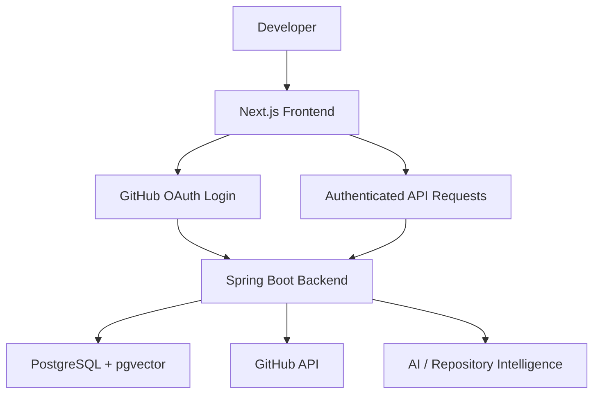

# GitCrawler — Frontend

<p align="center">
  <strong>AI-Powered GitHub Repository Intelligence Platform</strong>
</p>

<p align="center">
  Analyze repositories, explore codebases, and interact with your GitHub projects through an AI-powered interface.
</p>

<p align="center">
  
  
  
  
  
</p>

---

## Overview

GitCrawler is an AI-powered GitHub repository intelligence platform designed to help developers understand and navigate their codebases more efficiently.

The frontend provides a modern web interface for GitHub authentication, repository discovery, AI-assisted codebase exploration, and repository-related workflows.

Built with Next.js and TypeScript, the application communicates with a Spring Boot backend that handles authentication, repository operations, data persistence, and AI integration.

## Features

- **GitHub Authentication** — Sign in using GitHub OAuth 2.0.
- **Repository Discovery** — Access and explore repositories associated with your GitHub account.
- **AI-Powered Codebase Intelligence** — A user interface for interacting with repository analysis capabilities.
- **Repository Chat** — An interface for repository-focused AI conversations.
- **Session-Aware Authentication** — Integrate with backend-managed authentication sessions.
- **Modern UI** — Responsive layouts and reusable components built with Tailwind CSS and shadcn/ui.
- **Type Safety** — TypeScript for maintainable frontend development.

> Feature availability depends on the corresponding backend implementation and configuration.

## Tech Stack

| Technology | Purpose |
|---|---|
| Next.js App Router | React framework and routing |
| React | Component-based UI |
| TypeScript | Static typing |
| Tailwind CSS | Styling and responsive design |
| shadcn/ui | Reusable UI components |
| Lucide React | Icons |
| TanStack Query | Server-state and asynchronous data management |
| Spring Boot REST APIs | Backend communication |
| GitHub OAuth 2.0 | Authentication |

## Architecture



The frontend is responsible for presentation, navigation, and user interactions. Authentication, repository processing, persistence, and AI-related operations are handled by the backend.

## Getting Started

### Prerequisites

- Node.js 22 or a compatible supported version
- npm
- Git
- A running GitCrawler backend

### 1. Clone the repository

```bash
git clone https://github.com/devch105/gitcrawler-frontend.git
cd gitcrawler-frontend
```

### 2. Install dependencies

```bash
npm install
```

### 3. Configure environment variables

Create a `.env.local` file in the project root:

```env
NEXT_PUBLIC_BACKEND_URL=http://localhost:8080
```

Replace the URL with your deployed backend URL when running against a remote environment.

Do not place GitHub client secrets, database credentials, or other private keys in `NEXT_PUBLIC_*` variables. Next.js exposes these variables to the browser.

### 4. Start the development server

```bash
npm run dev
```

Open [http://localhost:3000](http://localhost:3000).

### 5. Build for production

```bash
npm run build
npm run start
```

## Project Structure

```text
gitcrawler-frontend/
├── app/                 # App Router pages and layouts
├── components/          # Reusable UI components
├── context/             # Shared application state
├── lib/                 # API clients and utilities
├── public/              # Static assets
├── .env.local           # Local environment configuration
├── next.config.ts       # Next.js configuration
├── package.json
├── tsconfig.json
└── README.md
```

The exact structure may vary as the application evolves.

## Backend Integration

The frontend communicates with the Spring Boot backend over HTTP.

Typical integration responsibilities include:

- Initiating GitHub OAuth login.
- Retrieving the authenticated user's session.
- Listing and synchronizing repositories.
- Managing repository-related chat sessions.
- Sending authenticated API requests.

When using session-based authentication locally, configure the backend's CORS policy to allow the frontend origin and credentials. Browser requests must include credentials when the backend relies on session cookies.

## Deployment

The frontend can be deployed to a Next.js-compatible hosting provider, including Render.

Before deployment:

1. Set `NEXT_PUBLIC_BACKEND_URL` to the correct backend base URL.
2. Configure the backend's allowed frontend origin.
3. Ensure HTTPS is enabled for production authentication flows.
4. Verify cookie settings and credentialed cross-origin requests.
5. Configure GitHub OAuth callback and redirect URLs on the backend and in GitHub OAuth App settings.

## Development

```bash
npm run dev       # Start development server
npm run lint      # Run ESLint, if configured
npm run build     # Create production build
npm run start     # Run production server
```

## Related Repository

- **Backend:** [GitCrawler Backend](https://github.com/devch105/gitcrawler-backend)

## Contributing

Contributions and suggestions are welcome.

1. Fork the repository.
2. Create a feature branch.
3. Commit your changes.
4. Open a pull request describing the changes.

## License

This project is distributed under the MIT License if a corresponding MIT license is included in the repository. Otherwise, update this section to reflect the project's actual license.
